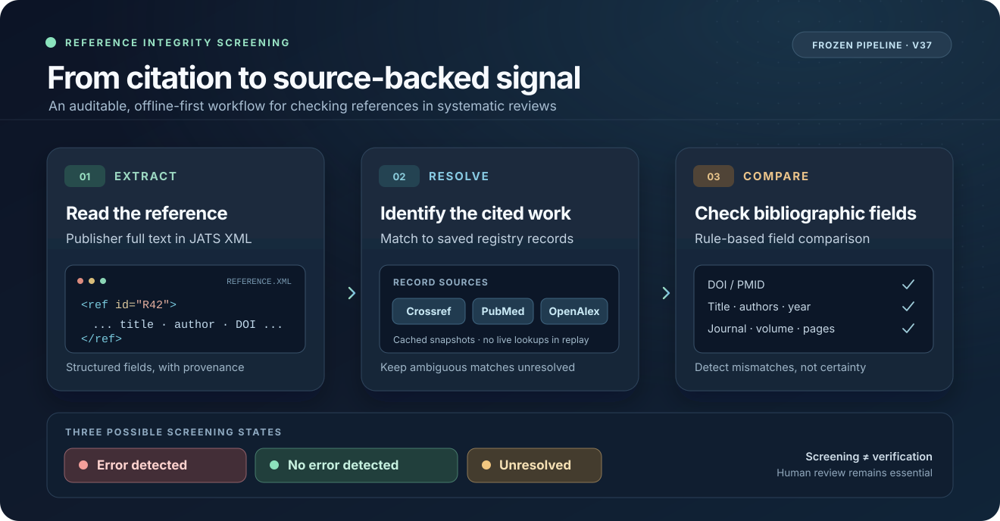

# Reference Integrity Screening

**A transparent research pipeline for detecting bibliographic errors in systematic reviews.**



Reference Integrity Screening extracts citations from publisher JATS XML, identifies the cited work using **saved registry records**, and compares its DOI/PMID, authors, title, journal, year, volume, and pages. Each reference receives one of three screening states: **error detected**, **no error detected**, or **unresolved**.

This is the **frozen v37 research pipeline** supporting a study of reference integrity in biomedical systematic reviews—not a hosted application or a guarantee that every error will be found.

## Research snapshot

| Scope | Independent validation | Sensitivity | Specificity |
| :-- | :-- | :-- | :-- |
| **7,627,028 references** in 119,030 reviews | **2,160 references**, investigator-rated | **59.8%** (95% CI 55.6–64.1) | **96.9%** (95% CI 95.6–98.1) |

In the stratified, weighted validation among resolved references, positive predictive value was **80.2%** (95% CI 71.8–88.4) and negative predictive value was **91.8%** (95% CI 90.6–93.0).

> **Important:** This is a screening tool, not a definitive citation validator. **“No error detected” does not mean “verified correct.”** Estimates refer to the frozen research version and its specified evaluation sample, not to an independently tested user-facing product.

## How it works

1. **Extract** — Parse a reference from JATS XML, preserving identifiers and the printed bibliographic fields.
2. **Resolve** — Identify the cited work against previously saved Crossref, PubMed, and OpenAlex records. The recorded census used cached responses rather than live requests.
3. **Compare** — Apply the frozen rule chain to check identifiers and bibliographic fields against the resolved work.
4. **Screen** — Return *error detected*, *no error detected*, or *unresolved* so that reviewers can prioritize human verification.

The illustration above is conceptual. The repository exposes **research scripts**, not a graphical interface.

### What the output means

| Screening state | Interpretation | Appropriate next step |
| :-- | :-- | :-- |
| **Error detected** | One or more checked fields conflict with the identified work. | Inspect the printed citation and source records. |
| **No error detected** | No mismatch was detected by the frozen rules. | Do **not** treat this as a guarantee of accuracy. |
| **Unresolved** | The cited work could not be established from the available records. | Resolve manually or obtain additional source evidence. |

## Try the included tests

The repository includes synthetic unit tests. They do **not** require the unpublished census dataset or registry caches.

```bash
git clone https://github.com/tuyentran-md/reference-integrity-screening.git
cd reference-integrity-screening

python3 -m venv .venv
source .venv/bin/activate
python -m pip install lxml XlsxWriter openpyxl pytest

cd screening
python -m pytest -q
```

The original run used **Python 3.14.4**, `lxml 6.1.1`, and `XlsxWriter 3.2.9`. For figure generation, the original scripts additionally use R (`ggplot2`, `jsonlite`, `cowplot`) and Playwright.

## Repository guide

`screening/` contains the frozen source used for the research pipeline.

| Location | Role |
| :-- | :-- |
| `vendor/` | Copied reference parser (S02 v2.5) and identity-resolution chain (S03 v35 with rule patches). |
| `frozen.py`, `registry.py`, `byline.py` | Cache-backed resolution, registry records, and JATS author bylines. |
| `rules.py` → `v36b/rules.py` → `v36c/rules.py` → `v37/rules.py` | Successive rule layers; **`v37/rules.py` is the final frozen rule set**. |
| `run.py`, `v37/census.py` | Processing and census execution. |
| `jats.py` | Single-JATS entry point; parity with the v37 census path is under developer review. |
| `packet.py`, `exclusions.py`, `v37/validation.py` | Stratified sampling and blinded validation packets. |
| `v37/metrics.py`, `v37/prevalence.py` and related analysis scripts | Validation metrics, prevalence, tables, and trends. |
| `v37/fig1_diagram.py`, `v37/figures.R` | Manuscript figure generation. |
| `tests/` | Unit tests using synthetic inputs. |

`RELEASE_MANIFEST.json` maps released files to SHA-256 hashes of the frozen source. Release-specific substitutions concern configuration, relative paths, user-agent text, or comments; the rule logic was not intentionally altered. The v37 census entry point also checks the hash of `v37/rules.py`.

## Data and reproducibility

**Source code is published; research data are not included in this repository.** Excluded materials include the 120-shard census, saved registry responses (SQLite), validation workbooks, and investigator ratings.

Exact numerical reproduction requires the saved response caches and source data from the original run. Scripts expect these in the documented research layout, including `census_s03_v35_20261019/`, `code/cache/`, `pipeline/cache/`, `census_20261013/`, `screening/data/`, and `screening/v37/validation/`.

The original cache keys included the collection contact address; exact replay also requires `RIS_MAILTO` to match that address. A different value can produce cache misses, even when the rules are unchanged. **Without those caches, the repository supports inspection and synthetic tests but does not reproduce the complete published analysis.**

## Release status

**Pre-release — open for independent developer review.** The code is visible for inspection, but this repository **does not yet include a reuse license**. A citation file, packaged dependencies, integration tests, and a documented release tag are planned for the public research-software release.

Please do not interpret this repository as a clinical decision-support system or as evidence of diagnostic performance in patient care.
